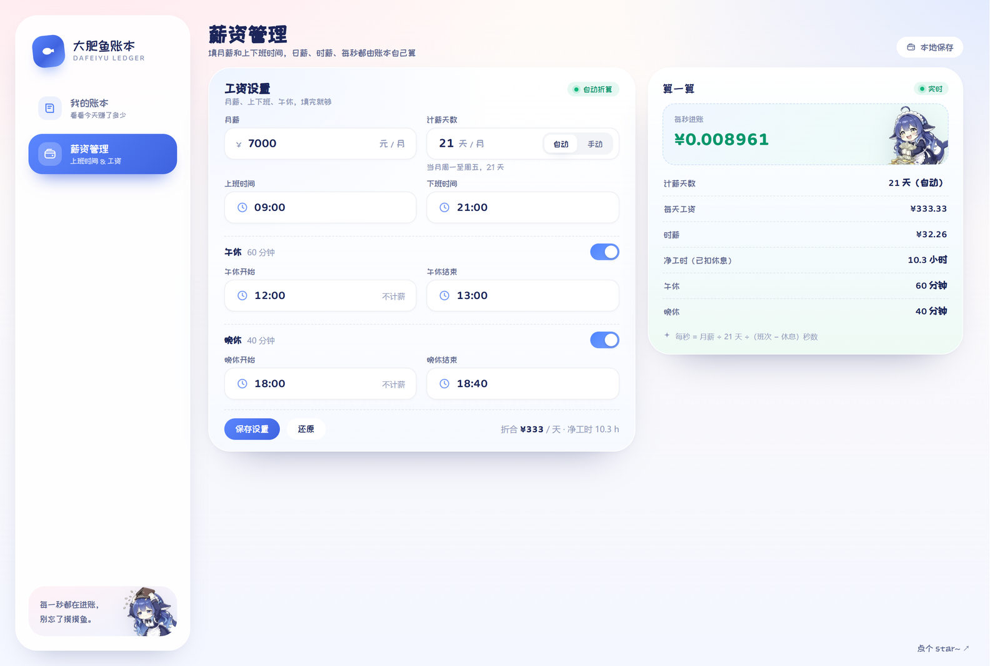

<div align="center">

<h1>大肥鱼账本 · Dafeiyu Ledger</h1>

<p><b>上班的时候，看着钱一秒一秒长出来。</b></p>

<p>一个可爱风的「牛马激励器」：大肥鱼戴着牛头帽打算盘，头顶的绿色数字跟着秒针往上跳。</p>

<p>
  <a href="https://github.com/linsk27/dafeiyu-ledger/releases/latest"></a>
  <a href="https://github.com/linsk27/dafeiyu-ledger/blob/main/LICENSE"></a>
  
  
</p>

<p>
  <a href="https://github.com/linsk27/dafeiyu-ledger/releases/latest"><b>📱 下载 Android APK</b></a>
  &nbsp;·&nbsp;
  <a href="https://linsk27.github.io/dafeiyu-ledger/"><b>🌐 在线打开（手机也能用）</b></a>
  &nbsp;·&nbsp; 本地 <code>pnpm install && pnpm dev</code>
</p>

</div>


---

## 它是什么

打开它，大肥鱼就坐在你的工位上打算盘，头顶的数字每秒跳一次——那是你今天到目前为止赚到的钱。

- 数字精确到 **4 位小数**，每跳一格就飘出一枚 `+0.0090` 的小药丸
- 上班前它抱着空钱包哭，下班后它躺进钱堆里发光
- 点它一下会有反应（五个状态各有各的反应）
- 想更专注就按「沉浸模式」，全屏只剩数字和它

## 截图

| 白天上班 | 夜里上班 |
|---|---|
|  |  |

| 午休 / 晚休 | 戳醒它 |
|---|---|
|  |  |

| 下班后 | 沉浸模式 |
|---|---|
|  |  |

| 薪资管理 | 手机 |
|---|---|
|  |  |

## 五个状态

角色的立绘和背景会跟着时间自己换，白天用白天的工位、夜里用夜里那张：

| 时段 | 角色 | 背景 |
|---|---|---|
| 上班前 | 抱空钱包、快哭了 | 白天/夜里的工位 |
| 上班中 | 戴牛头帽、打算盘的「牛马大肥鱼」 | 同上（按当时钟点） |
| 午休 | 趴在枕头上睡着 | 阳光白床 |
| 晚休 | 同上 | 台灯蓝床 |
| 下班后 | 抱着钱堆、眼里发光 | 白天/夜里的工位 |

`6:00–18:00` 算白天，其余算夜里；午休/晚休则按**这段休息自己几点开始**判断（18:00 的晚休永远是夜里那张床）。

### 戳一戳

五个状态都能点，各有一张反应图，1.9 秒后自动切回：

| 时段 | 反应 | 文案 |
|---|---|---|
| 上班前 | 气得抖钱包 | 钱包：真的挤不出来了 |
| 上班中 | 摔算盘 | 算盘摔了！这破班谁爱上谁上 |
| 午休 | 被吵醒、冒火 | 谁！谁戳我！ |
| 晚休 | 同上 | 醒了醒了，别戳了 |
| 下班后 | 举着钞票撒钱 | 发工资啦！钱给我撒起来 |

切图是**互斥硬切**（`opacity` 不做过渡，靠入场动画），不会出现两张图叠在一起。

## 薪资管理

只填四件事：**月薪**、**上下班时间**、**午休**、**晚休**。日薪 / 时薪 / 每秒全部自动算。

- **时间选择器是自绘的**：时列 + 5 分钟宫格 + 常用值快选，放不下会自动往上翻
- **午休 / 晚休各有开关**，没有的直接关掉；开关打开时如果时间落在班次外，会自动挪进班次
- **计薪天数**默认「自动」（当月周一~周五），也可以切「手动」用日历勾选——法定节假日点掉、调休补班的周六点上来
- 右边小票实时显示：每天工资、时薪、净工时、午休/晚休时长、每秒

## 沉浸模式

按「沉浸模式」请求全屏，换成深色背景 + 一张铺满的卡片，数字放大到 `clamp(42px, 6vw, 88px)`。

- 全屏被系统踢掉（切窗口、按 Esc）时，沉浸视图**不会跟着关**，只多出一个「重新全屏」
- 也能直接用 `?immersive=1` 打开

## 计薪口径

```text
日薪     = 月薪 ÷ 计薪天数            // 自动 = 当月周一~周五天数
净工时   = 下班 − 上班 − 午休 − 晚休
每秒     = 日薪 ÷ 净工时秒数
已赚     = clamp(0, 已工作净秒数 × 每秒, 日薪)
```

例子：月薪 7000、09:00–21:00、午休 60 分钟、晚休 40 分钟 → 计薪 21 天 → 日薪 ¥333.33 → 净工时 10.3h → **每秒 ¥0.008961**。

午休和晚休期间数字**冻结**（不涨也不飘字），下班后封顶日薪。

## 技术栈

React 19 · Vite 6 · TypeScript · framer-motion · Capacitor 7（Android）

```text
src/
  App.tsx                 外壳、1s 心跳、预览时间偏移、沉浸开关
  lib/salary.ts           全部计算（时间轴/休息/日薪/每秒/已赚/进度）
  lib/storage.ts          localStorage v2 + 老数据迁移 + 休息时间自愈
  components/Stage.tsx         角色舞台（五个状态 × 昼夜）
  components/MoneyCounter.tsx  绿色数字 + 每秒飘字
  components/TimeField.tsx     自绘时间选择器
  components/DayPicker.tsx     手动计薪日 · 月历
  components/Immersive.tsx     全屏激励器
  pages/LedgerPage.tsx    我的账本
  pages/SalaryPage.tsx    薪资管理
  styles.css              全部样式（无 UI 框架）
public/assets/            角色立绘、背景、光标（全部本地）
public/fonts/             站酷快乐体 + Baloo 2
```

## 本地跑

```bash
pnpm install
pnpm dev      # http://127.0.0.1:5273
pnpm build
```

数据只存 `localStorage`（键 `dafeiyu-ledger:v2`），没有后端，也不上传任何东西。

## 打包 Android

```bash
pnpm build
node node_modules/@capacitor/cli/bin/capacitor copy android
cd android && ./gradlew assembleDebug
# → android/app/build/outputs/apk/debug/app-debug.apk
```

需要 JDK 21（Capacitor 7 的编译目标）、Android SDK 35、build-tools 35。

## 在线版（GitHub Pages）

<https://linsk27.github.io/dafeiyu-ledger/>

Hosting 走的是 `gh-pages` 分支（不是 Actions，理由见下），发布步骤：

```bash
pnpm build
# 把 dist/ 里的东西推到一个孤儿分支
cd dist && git init -q -b gh-pages && touch .nojekyll
git add -A && git commit -m "deploy" && git push -f <remote> gh-pages:gh-pages
```

为什么不用 Actions 自动部署：这台机器上的 Personal Access Token 没有 `workflow` 权限
（`refusing to allow a Personal Access Token to create or update workflow ... without 'workflow' scope`），
推不了 `.github/workflows/*.yml`。给 token 勾上 `workflow` 之后，把 `pages.yml` 加回去就能每次 push 自动部署。

## iPhone

**没有 `.ipa`**：iOS 的应用包必须在装了 Xcode 的 Mac 上签名，签发还需要 99 美元/年的开发者账号。这台机器两样都没有，所以 iPhone 走 PWA——直接从 Safari 装到主屏幕，图标、启动图、全屏、离线缓存都有，用起来和 App 差不多：

1. Safari 打开部署地址（**必须是 HTTPS**，`http` 装不上）
2. 底部「分享」→「添加到主屏幕」
3. 从主屏幕打开，就是无地址栏的全屏应用

已经为它做好的适配：

- `apple-touch-icon`（180×180 满幅方形，圆角交给 iOS 自己切）和 5 组 `apple-touch-startup-image` 启动图，覆盖 1170×2532 / 1284×2778 / 1179×2556 / 1290×2796 / 828×1792
- `manifest.webmanifest`：`display: standalone`、`orientation: portrait`、192/512 图标 + 一张 maskable
- 刘海与底部横条：`env(safe-area-inset-*)` 收进 `--safe-top/bottom/left/right` 四个变量，外层 padding、固定页脚、沉浸层都让开
- `100dvh`（Safari 的 `100%` 会把地址栏算进去，底部内容容易被折住）
- 输入框字号 19px（iOS 的规则是 <16px 聚焦时自动放大整页）

两处 iOS 与 Android 的行为差异：

- Safari 不支持 **Fullscreen API**，所以沉浸模式里没有「重新全屏」按钮，点「沉浸模式」直接进全屏视图（用 `position: fixed` 铺满，不是真全屏）
- 触屏没有 hover，指针的 hover 态不会出现；`active` 的下沉反馈保留

## 踩过的坑

- **字体抽搐**：`@fontsource` 把中文切成 180 多个 unicode-range 分片，首屏先出系统字体、几百毫秒后换字，行宽一变整页回流。改成单文件 woff2 + `preload` + `font-display: block`，CLS 归零，样式表也从 181 KB 降到 31 KB。
- **APK 体积翻倍**：删掉 `public/assets` 里的旧 PNG 后增量打包会留下死空间，`gradlew clean` 一下从 21 MB 回到 9 MB。
- **Maven Central 403**：某台机器上 Gradle 拿不到依赖（curl 却是 200），靠 `init.d/mirrors.gradle` 改写成镜像解决。
- **`position: fixed` 的页脚链接**：跟在文档流里时，两个页面内容高度不同会让它在「内容末尾」和「视口底部」之间跳。

## 字体与素材

- 中文 **站酷快乐体**、数字 **Baloo 2**，都是自托管 woff2，不依赖 Google Fonts
- 角色立绘、背景图全部本地打包，生产构建时由 Service Worker 缓存（cache-first）

## 版权

代码是 **MIT**。但**角色美术不在此列**：

大肥鱼是社区同人形象，表情包来自 [diwer/ai-biaoqingbao](https://github.com/diwer/ai-biaoqingbao)（CC BY-NC-SA 4.0，角色设计 ZipZipPipe、上善无形），仓库里的立绘由作者提供，只用于这个项目，**请勿商用或二次分发**。

## 版本记录

<details>
<summary>点开看每一版改了什么</summary>

- **v1.18** 午休/晚休也能戳，戳醒用生气那张
- **v1.17** 五个时段卡片高度统一（都 579px / 手机 399px）
- **v1.16** 休息换成睡姿立绘
- **v1.15** 打开 App 时自动把「落在班次外」的休息时间挪进去
- **v1.14** 开关休息时自动择时；晚休一律用夜里那张床
- **v1.13** 休息没生效时，预览按钮置灰并说明原因
- **v1.12** 休息的昼夜按「这段休息几点开始」判断
- **v1.11** 接入床景，休息时段换成卧室
- **v1.10** 上班中按真实钟点切昼夜；修预览下休息仍在跳数
- **v1.9** 手动月历去掉翻月；修两处布局抖动
- **v1.8** 手动计薪日确定「只算一个月」
- **v1.7** 计薪天数改成日历勾选
- **v1.6** 去掉 Android 上永远不会出现的「重新全屏」
- **v1.5** 新增晚休 + 冲突提示改版
- **v1.4** 窄屏顶栏不再把「薪资管理」挤出去
- **v1.3** 手机切 tab 掉帧（去毛玻璃）、表单溢出
- **v1.2** 页脚链接指向仓库
- **v1.1** 启动画面、首启引导、状态栏避让

</details>
